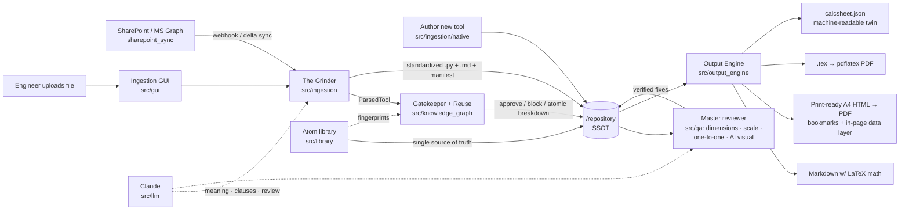

# AI-Augmented Structural Engineering Toolchain — Architecture

## Purpose

Convert legacy engineering calculation files (Mathcad, Excel, Python,
Jupyter) into a single version-controlled repository of standardized
Python tools paired with strict Markdown documentation, guarded by an AI
gatekeeper against duplication, and rendered into Mathcad-like A4 reports
for non-coder review.

## Module Map



**Principle throughout: AI proposes, deterministic code disposes.** The
model assigns meaning, researches clauses and reviews the rendered report;
every number is computed by the CalcSheet engine, and an AI correction is
only kept when the deterministic re-check of the patched sheet is better.
With no AI configured every stage still runs (heuristics, the atom
library, deterministic review) and says so in the audit trail.

## Core Design Decision: Calculation IS Visualization

The single source of truth for every tool is a `CalcSheet`
(`src/models/calculation.py`). Each `sheet.calc("w_k", "s_r_max*(eps_sm-eps_cm)")`
call simultaneously:

1. **evaluates** the expression numerically (via sympy),
2. stores the **symbolic LaTeX** form,
3. stores the **substituted LaTeX** form (values injected into the formula).

Renderers never re-implement math: they only walk the sheet. Change an
input, re-render, and every number in the Markdown/HTML/LaTeX report
updates — exactly like a Mathcad worksheet, never a stale `print()`.

**Units.** Sheets from unit-carrying sources (Mathcad) run in
*unit-aware* mode: inputs are converted to canonical N/mm, a unit written
inside a formula (`h - 30 mm`) becomes a unit symbol carrying its scale,
results are shown in the unit the source displayed (or, when it showed
none, the canonical unit of the result's dimension), and the substituted
line prints every value with its own unit, Mathcad style:
`P = 0.8·450 MPa·π·(19 mm)²/(4·1.25) = 81.66 kN`. Unit-naive sources
(legacy Excel with hand conversions like `*1e6`) keep their numbers as
written; the master reviewer checks their scale. Large/small numbers print
as `1.584·10⁶`, never `1.584e+06`.

**Conditionals and rounding** are part of the engineering result, so they
are translated, never dropped: Mathcad `if` / `if…otherwise` programs and
Excel `IF/AND/OR` become `Piecewise`; equality conditions become `Eq(…)`
(sympy would otherwise fold `x == 1` to False at parse time); Mathcad
`round` and Excel `ROUND/ROUNDUP/ROUNDDOWN/TRUNC/INT` keep their exact
semantics (`ROUND(20/3, 0) = 7`, not 6.67).

**Faithful display.** Numbers are computed from an evaluated parse, but
the *displayed* formula comes from a separate non-evaluated parse
(`_parse_display`, using sympy's `evaluate(False)`), so a formula renders
the way it was written — `sqrt(28/t)` stays `√(28/t)` instead of being
auto-rewritten to `2·√7·√(1/t)`. Atoms preserve their original source
string and rename symbols textually for the same reason.

### Report path to PDF (non-coder workflow)

| Output | Produced by | PDF route | Needs install? |
|---|---|---|---|
| `.md` | `render_markdown` | rendered inline by GitHub/GitLab | no |
| `.html` | `render_html` | open in browser → Ctrl+P, or automated: `render_pdf_browser` (headless Chromium) → A4 PDF with colored header/footer | Chromium for the automated path |
| `.tex` | `render_latex` | `pdflatex`/tectonic → typeset PDF | TeX Live |

Math in the HTML report is pre-rendered to **inline SVG at generation
time** (matplotlib mathtext), so the file is fully self-contained: no
internet, no MathJax CDN, works in locked-down corporate environments.
The HTML route is the default for reviewers; the LaTeX route is for
formal typeset deliverables once TeX Live is available in CI.

## Agentic ingestion (src/ingestion/agent) — the thorough path

`python main.py ingest <file>` runs the full agentic workflow — thorough
over fast, convergence as the exit condition:

```
intake ─► gatekeep ─► [ decompose → research → clarify → reconstruct → verify ] ─loop─► reflect (+ master review loop) → deliver
```

- **intake** atomises the source into *fragments* (inputs, formulas,
  checks, narrative, sketches — incl. Mathcad's BMP-in-.png images,
  converted; header logos auto-flagged as noise).
- **gatekeep** asks the central knowledge base first: is this already a
  tool (duplicate / similar score)? Which formulas are library atoms or
  live in other tools? If a near-duplicate exists the engineer chooses:
  *revise* it (new revision of the existing tool), keep a *new tool*, or
  *abort*. Re-converting the same tool bumps its revision.
- **decompose** builds the dependency graph, finds unused inputs (noise
  candidates), repetitive structures, orphans.
- **research** attaches a code clause to every formula: citations found in
  the source narrative, structural matches against the atom library (which
  outrank the model), the document-level standard, and — when an LLM is
  configured — one structured research pass that assigns clauses and
  equation numbers with a confidence, notes validity limits, and lists
  steps the code requires that the sheet omits (surfaced in the
  reflection checklist).
- **clarify** asks the engineer **inline, while building** — governing
  load case for vector inputs, values for untranslatable constructs
  (never fabricated), keep/discard for noise, the final governing result
  (e.g. UR) and its acceptance criterion, layout, sketch placement and
  captions. Channels: console prompts, scripted answers (batch), or
  defer-mode (never blocks, never silently drops).
- **reconstruct** rebuilds a clean, compact tool in a *stable* dependency
  order (the author's sequence, moved only where a dependency demands).
- **verify** recomputes everything, replicates source cached values,
  runs the units reviewer, checks completeness — then the loop repeats
  until clean or until only human-deferred items remain (it never spins
  and never invents an answer to force progress).
- **reflect** runs the per-value self-review checklist (units known,
  clause present, checks pass), then the **master reviewer loop** (below)
  against the original's values; every verified correction is written back
  into the fragments, so the generated `.py`, the report, the manifest and
  the journal agree — and the corrected step carries a visible
  *Reviewer correction* note.
- **deliver** writes the tool + reports + the shared `manifest.json` +
  `casefile.json` + `JOURNAL.md` (every stage, question, answer, decision
  and correction — no black box). `--original print.pdf` lets the AI read
  the values the original shows, for the one-to-one check.

## The Grinder (src/ingestion)

- `base.py` — parser registry; one class per format.
- `excel_parser.py` — the Excel entry point `AIExcelParser` **dispatches**:
  convention sheets (INPUTS/CALCULATIONS/CHECKS) take the exact deterministic
  fast-path (`ConventionExcelParser`); everything else goes through the AI
  pipeline. Also hosts the cross-sheet formula translator
  (`translate_excel_formula`) and the CSV variant.
- `notebook_parser.py` / `python_parser.py` — line-convention extraction
  (`name = expr  # unit | description`).
- `mathcad_parser.py` — Mathcad Prime `.mcdx` (OPC zip):
  `mathcad/worksheet.xml` regions in reading order, the `ml:` operator tree
  translated recursively (arithmetic, powers/roots, `min/max/round/…`,
  `if` functions and `if/otherwise` programs, all comparison operators,
  units inside formulas, display-unit overrides), text regions from the
  XAML packages (title, clause, narrative), embedded sketches. Matrices,
  strings, empty placeholders, user functions and unknown units become a
  clarification. `examples/make_fixtures.py` builds a stud-resistance
  `.mcdx` in the real worksheet layout for tests.
- `grinder.py` — fast pipeline: parse → gatekeeper → reuse analysis (atom
  clauses carried into the report margin) → master review to convergence →
  write `repository/<slug>/{<slug>.py, <slug>.md, manifest.json, source/}`
  (+ `CLARIFICATIONS.md` when the AI parser needs human input).
- `manifest.py` — the one manifest format (schema `manifest@2`) written by
  the grinder, the agentic workflow and native registration, built from the
  final (reviewed) sheet.

### The AI Grinder (messy real-world sheets)

Rigid block-scanning fails on real legacy sheets (scattered tables, named
ranges, multi-tab, static values mixed with formulas). The AI pipeline
handles them in six stages, on the principle **"AI proposes, deterministic
code disposes"** — the LLM only assigns *meaning*, never does arithmetic:

1. **Extract** (`workbook_extract.py`) — openpyxl reads every sheet
   (formulas + cached values), named ranges, comments → a `WorkbookDigest`
   IR of non-empty cells only, grouped into **regions** (connected blocks),
   each cell tagged with its nearest text label.
2. **Digest/chunk** — never dump the grid. `to_markdown()` emits compact
   `cell | label | value | formula` tables with a **token budget** that
   always keeps formula cells (the logic) and samples value-only cells.
   This is the context-window control point.
3. **Interpret** (`interpret.py`) — an `Interpreter` interface with two
   implementations: `LLMInterpreter` (Claude via `llm_client.py`, strict
   JSON) and `HeuristicInterpreter` (deterministic label-adjacency +
   formula analysis, runs offline). Both emit the same `Interpretation`:
   variable dictionary, roles, a **cell→symbol map**, and clarifications.
4. **Translate** (deterministic, `translate_excel_formula`) — using the
   cell→symbol map, rewrite Excel formulas (incl. `Sheet2!B4` cross-sheet
   refs, `IF(...)` checks) to math syntax. Lookup functions
   (`INDEX`/`VLOOKUP`/…) and unmapped refs are **not** guessed — they raise
   a targeted clarification (with the cached value offered as a "freeze"
   fallback so the rest of the tool still works).
5. **Verify** (deterministic, `ai_pipeline.py`) — recompute via CalcSheet
   and compare to the workbook's own cached values; a mismatch becomes a
   `value-mismatch` clarification. So a wrong LLM guess is caught, not
   trusted.
6. **Assemble** → the same `ParsedTool` (now with `clarifications` and
   `interpreter`), consumed unchanged by the Knowledge Graph and writers.

**LLM backend (`src/llm`):** one client for every AI step.
`AnthropicLLMClient` uses the official SDK with streaming, adaptive
thinking at an explicit effort, **schema-constrained JSON**
(`output_config.format`, strict schemas in `src/llm/schemas.py`), image
and PDF document blocks for the visual review, server-side refusal
fallback, and typed errors (`LLMError`, `LLMRefusal`) that every caller
turns into its deterministic fallback. Default model `claude-opus-5-5`
(`TOOLCHAIN_LLM_MODEL`, `TOOLCHAIN_LLM_EFFORT`, `TOOLCHAIN_LLM=off`);
credentials from `ANTHROPIC_API_KEY` or an `ant auth login` profile.
`ScriptedLLMClient` answers by task for tests and dry runs; `python main.py
doctor` shows what is configured.

**Human-in-the-loop:** anything ambiguous (magic number with no label,
lookup that needs external data, circular/undeducible logic, value
mismatch) is written to `repository/<slug>/CLARIFICATIONS.md` as a specific
question pointing at the exact cell, and the tool's status becomes
`needs-clarification`. Nothing is silently dropped or fabricated.

## Knowledge Graph / Gatekeeper (src/knowledge_graph)

- `indexer.py` — walks `/repository` manifests → `.index.json` with a
  relationship map (tools sharing ≥2 variables).
- `similarity.py` — MVP scoring: TF-IDF cosine + fuzzy title + variable
  overlap. `EmbeddingBackend` protocol is the seam for a real LLM
  embedding service later.
- `gatekeeper.py` — blocks grinding at score ≥ 0.80 (duplicate), warns at
  ≥ 0.55 (similar). `check_request()` answers "would this idea be a
  duplicate?" before anyone writes a file.
- `fingerprint.py` — **name-independent structural fingerprint** of a
  formula (sympy canonicalization + shape-ordered symbol relabelling).
  `k_3*c + k_1*k_2*k_4*phi/rho` and `k3*cn + k1*k2*k4*d/rho` hash the
  same. Trivial shapes (< 3 ops) are excluded from matching.
  `parse_locals()` also prevents sympy from hijacking engineering names
  like `E`, `I`, `N`, `S`.
- `reuse.py` — the **atomic breakdown**: classifies every derived formula
  of an incoming tool as `matches_atom` (reuse the library), `matches_tool`
  (extract a shared atom) or `new`. This is what converges shared math
  into `src/library` instead of copy-paste.

## Atom Library — Single Source of Truth (src/library)

An *atom* is one named formula with provenance (code clause), canonical
symbols, units and a sympy expression. Atoms exist **once** and are reused
everywhere:

- Tools call `sheet.apply("E_cm_t", "ec2.concrete.E_cm_t")` instead of
  re-typing the formula — edit the atom, every tool updates.
- Atoms are directly callable: `custom.E_cm_t(E_cm=33000, f_cm_t=30, f_cm=38)`.
  This `custom.*` namespace is the seam that becomes the **Excel UDF
  bridge** (`=CUSTOM.E_CM_T(...)` via xlwings/PyXLL) — the same names work
  from Python and spreadsheets.
- National-annex variants become sibling atoms (`ec2.de.*`) overriding
  only the changed coefficients.

**Seeding strategy.** The library ships with a hand-written EC2 seed set
(`atoms_ec2.py`, plus EN 1994-1-1 headed-stud atoms in `atoms_ec4.py`). The intended bulk source is the
[`structuralcodes`](https://github.com/fib-international/structuralcodes)
project (fib / university effort implementing Eurocode & fib Model Code
clauses in Python, Apache-2.0): adapt its functions into atoms — keeping
clause references and verifying license/attribution — so that when a new
legacy sheet is ingested there is already a large corpus to fingerprint
and match against. This is the "compare against everything" starting point.

## Machine-readable layer INSIDE the PDF (src/output_engine/pdf_stamp.py)

Every generated PDF is **AI-proof on its own**: the complete calculation
(inputs, formulas, values, units, verdicts, reviewer corrections) is baked
into the page content as an invisible sentinel-wrapped
`base64(gzip(json))` block. Hand someone only the PDF and
`reconstruct_from_pdf()` gets the calculation back with any text
extractor — no attachment, no sidecar. Metadata carries a
`/CalcSheetSchema` key; an embedded-file attachment is **opt-in only**
(`render_pdf_browser(..., attach=True)`), because a second copy invites
drift. PDFs carry a document outline (bookmarks) from the section headings.

## Master reviewer (src/qa) — find, fix, re-check

`review_to_convergence(sheet, client=…, original_values=…)` loops
*review → plan fixes → apply to a replayed copy → keep only if strictly
better → repeat* until clean, stalled, or `max_iter`:

- **dimensional analysis** (`dimensions.py`) of every formula and check:
  non-homogeneous sums, a stress labelled kN, a force compared with a
  length. Empirical code formulas (`1 + √(200/d)`) are recognised and
  noted, not flagged; a bare number carrying a hidden unit (`45e6` = a
  moment in Nmm) is reported as a magic number.
- **scale consistency** (unit-naive sheets): recompute in canonical N/mm;
  a power-of-ten mismatch not explained by the formula's own conversion
  literals (`*1e6`, `(L/1000)**2`) is a units slip — also in checks, where
  a slip flips the verdict. Fix candidates (add the conversion / relabel
  the unit) are each replayed; the one that leaves the whole sheet
  consistent wins — e.g. relabelling would leave `P_Ed [kN] <= P_Rd [N]`
  wrong, so the conversion is chosen and the verdict correctly becomes
  NOT OK.
- **one-to-one correspondence** with the original's values (Excel cached
  values, or values the AI reads from a print of the original), at the
  printed precision; a power-of-ten disagreement where the converted
  value is dimensionally verified is reported as the ORIGINAL's slip.
- **AI review** (when configured): rendered page images + the calc JSON +
  the original document go to the model, which returns findings and
  concrete corrections; each correction is applied only if the
  deterministic re-check improves.

Every applied fix lands in `sheet.review_log` (embedded in the PDF and the
manifest) and as a note under the corrected step. `python main.py review
<slug> [--original print.pdf] [--fix]`.

Also in `src/qa`: `checks.py` (deterministic lint: unused inputs, missing
verification, magic numbers, metadata, **library-bypass**) and
`ai_reviewer.py` (`build_review_prompt()` for paste-into-any-LLM, and
`AnthropicReviewer` for an advisory engineering-judgment review through
the shared client).

## Ingestion GUI (src/gui) & native authoring (src/ingestion/native)

- `gui/app.py` — the front door: pick a file → **Investigate** (parse +
  gatekeeper + atomic reuse, nothing written) → decide **Create /
  Force-create / walk away and extend**. Controller logic is separated
  from tkinter so it is unit-tested and reusable by a future web UI.
- `native.py` — author brand-new tools without a legacy file:
  `scaffold_tool()` writes a starter `build_sheet()`, `register_tool()`
  generates the same manifest + standardized doc the Grinder produces, so
  native and converted tools are indistinguishable downstream. See
  `docs/AUTHORING_GUIDE.md`.

## SharePoint Sync (src/sharepoint_sync) — placeholders

Client-credentials MS Graph client + webhook handshake/notification
handlers, with the subscription-renewal and delta-sync strategy documented
in the module docstrings. Secrets come exclusively from environment
variables (see `.env.example`).

## Version Control & CI/CD Strategy

- **Now (prototyping):** GitHub — `.github/workflows/toolchain-ci.yml`
  runs the test suite on every push.
- **Production:** enterprise GitLab. `.gitlab-ci.yml` (kept in this folder,
  move to repo root on migration) mirrors the same stages so the pipeline
  is a copy, not a rewrite: `test` → `gatekeeper-index` → `render-docs`.
- Secrets (MS Graph, embedding API, `ANTHROPIC_API_KEY`) are **CI/CD
  variables**, never files: identical variable names on both platforms
  (`MSGRAPH_*`, `KG_*`, `WEBHOOK_*`, `TOOLCHAIN_LLM_*`) so migration is
  configuration-only. Tests never call the API (scripted client).
- Webhook receiver deploys as a small always-on service (Azure Function /
  container) — CI only builds it; it is *not* a CI job.

## Repository Layout (SSOT)

```
repository/
  <tool_slug>/
    <tool_slug>.py     # executable CalcSheet builder — THE tool
    <tool_slug>.md     # standardized doc (template + live-rendered calc)
    manifest.json      # manifest@2: metadata, per-formula fingerprints and
                       #   clauses, reuse breakdown, gatekeeper matches,
                       #   master-review summary, review_log, revision
    source/<original>  # legacy file kept for provenance/audit (converted tools)
    reports/           # generated md/html/tex/pdf/calcsheet.json (rebuildable)
  .index.json          # knowledge-graph cache (rebuildable)
```

`source_format` is `native` for hand-authored tools (no `source/`) and
`xlsx`/`ipynb`/`py`/`csv`/`mcdx` for converted ones.
